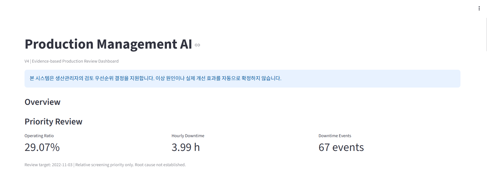

# Production Management AI

### Evidence-Based Manufacturing Decision Support System



*V4 Streamlit Dashboard — Production KPI, Evidence Validation & Action Tracking*

**Python · Pandas · Rule-Based Validation · OpenAI API · SQLite · Streamlit**

생산 데이터를 분석해 운영상 이상 징후를 탐지하고, 근거를 검증한 뒤 생산관리자가 우선 확인해야 할 사항과 후속 조치 현황을 관리하는 의사결정 지원 프로젝트입니다.

단순한 이상 탐지나 AI 보고서 생성을 넘어, **데이터 분석 → 근거 검증 → 검토 우선순위 선정 → 추가 점검 → 조치 이력 관리 → 개선 효과 검증 조건 확인**까지 연결하는 구조를 구현했습니다.

> **Core Principle**
>
> Calculation by Python → Validation by Rules & Evidence → Interpretation by LLM → Human Review & Action Tracking

LLM은 KPI를 직접 계산하지 않으며, 확인되지 않은 원인을 확정하지 않습니다.

---

## 1. Project Overview

### Background

생산관리자는 생산량, 설비 가동시간, 비가동 이력 등 서로 다른 데이터를 함께 확인해야 합니다.

그러나 단순히 KPI가 낮거나 비가동 이벤트가 많다는 사실만으로 실제 문제의 원인이나 대응 우선순위를 결정하기는 어렵습니다.

특히 다음과 같은 문제가 발생할 수 있습니다.

- 데이터 누락 및 집계 기준 차이로 인한 잘못된 KPI 판단
- 이상치 탐지와 실제 운영상 점검 우선순위의 혼동
- 비가동 시간과 발생 빈도를 구분하지 않는 분석
- LLM이 검증되지 않은 원인을 사실처럼 서술하는 문제
- 분석 결과와 후속 점검·조치 기록의 단절
- 조치 완료와 개선 효과 검증을 동일하게 취급하는 문제

### Objective

본 프로젝트는 생산관리자의 판단을 대체하는 것이 아니라, **무엇을 먼저 확인해야 하며 그 판단의 근거는 무엇인지 추적할 수 있도록 지원하는 것**을 목표로 합니다.

---

## 2. System Architecture

```text
Manufacturing Dataset
        |
        v
Data Quality Validation
        |
        v
Python KPI Calculation
        |
        v
Operational Screening
        |
        v
Evidence Validation
        |
        v
Specialist AI Agents
        |
        v
Production Manager Agent
        |
        v
Next Check Generation
        |
        v
SQLite Action Tracking
        |
        v
KPI Comparison Validation
        |
        v
Streamlit Dashboard
```

### Responsibility Separation

| Component | Responsibility |
|---|---|
| Python / Pandas | KPI 계산, 데이터 전처리, 정량 분석 |
| Rule Engine | 이상 탐지, 데이터 품질 및 비교 조건 검증 |
| Evidence Registry | 정량적 주장과 원천 근거 연결 |
| Specialist Agents | 담당 영역별 근거 해석 |
| Manager Agent | 검토 우선순위 및 확인 필요 사항 정리 |
| SQLite | 점검·조치 상태와 변경 이력 저장 |
| Streamlit | 분석 결과 및 검토 현황 시각화 |
| Human Reviewer | 원인 확인, 조치 판단 및 실제 실행 |

**중요:** AI의 해석 결과는 실제 원인 확정이나 현장 조치 승인과 구분됩니다.

---

## 3. Development History

### V1 — Production KPI & Exception Detection

직접 구성한 가상 생산 데이터를 이용해 분석 구조를 검증했습니다.

**Dataset**

- 가상 생산실적 20건
- 품목 A100, B200, C300, D400
- 생산계획, 생산실적, 불량, 가동 정보

**Implementation**

- 생산계획 달성률 계산
- 불량률 및 가동률 계산
- Rule 기반 이상 기록 탐지
- 반복 발생 패턴 분석
- OpenAI API를 활용한 보고서 생성

**Results**

- 이상 기록 8건 탐지
- B200 생산계획 달성률 저하 3회 확인
- Python 계산 결과와 LLM 해석 역할 분리

V1은 실제 제조기업의 운영 실적을 분석한 결과가 아닌 **Synthetic Data 기반 기능 검증 단계**입니다.

### V2 — Real Manufacturing Data Analysis

공개된 제조 생산운영 데이터로 분석 범위를 확장했습니다.

**Dataset**

| Data | Records |
|---|---:|
| Daily production | 59 |
| Hourly operation | 265 |
| Downtime events | 1,388 |

분석 대상 기간: **2022-07-22 ~ 2023-02-10**

**Implementation**

- 데이터 품질 및 정합성 검증
- 분석용 Canonical Dataset 구성
- 생산일별 KPI 계산
- Operating Loss / Downtime / Event Frequency 분석
- Percentile 기반 상대적 검토 우선순위 선정
- 비가동 이벤트 지속시간 Pareto 분석
- 통계적 이상치와 운영 우선순위 비교

**Key Findings**

2022-11-03은 상대적 Screening Rank 1위로 선정됐습니다.

| Metric | Value |
|---|---:|
| Operating Ratio | 29.07% |
| Hourly-record Downtime | 약 3.99시간 |
| Downtime Events | 67건 |

또한 전체 Downtime Event 중 지속시간 상위 약 10%가 전체 이벤트 기록시간의 **70.87%**를 차지했습니다.

이 결과는 정지 횟수뿐 아니라 장시간 정지 기록을 별도로 검토할 필요가 있음을 보여줍니다.

다만 Screening Rank는 실제 사업장 관리기준이나 확정된 원인 분석 결과가 아닙니다.

### V3 — Evidence-Grounded Multi-Agent Analysis

V2 분석 결과를 기반으로 역할이 구분된 AI 분석 구조를 구현했습니다.

**Specialist Agents**

- Production Agent
- Downtime Agent
- Efficiency Agent
- Pattern Agent

각 Agent는 담당 영역의 근거를 해석하고, Production Manager Agent가 결과를 종합합니다.

**Design Principle**

- 정량 지표는 Python에서 계산
- Agent는 제공된 Evidence 범위 내에서 해석
- 원인에 대한 가설과 확인된 사실 구분
- 근거가 부족한 경우 `NOT_ESTABLISHED` 또는 추가 검토 필요 상태 유지

V3는 분석 의견을 생성하지만, 자연어 보고서 전체의 모든 주장을 자동으로 사실 검증한 것은 아닙니다. 이러한 한계를 보완하기 위해 V4를 개발했습니다.

### V4 — Evidence-Based Review & Action Management

V4는 AI 분석 결과를 생산관리자가 검토하고, 필요한 점검 사항을 관리할 수 있도록 확장한 단계입니다.

#### V4-A. Evidence Validation

- V2 분석 근거를 Evidence Registry와 연결
- 정량적 주장 검증
- 지표값·단위·근거 일치 여부 확인
- 근거가 부족한 주장과 원인 해석 구분

**Demonstration:** 2022-11-03 관련 수치 사실 5건 검증 통과

#### V4-B. Next Check Engine

검증된 분석 근거를 바탕으로 후속 점검 질문을 생성합니다.

**Example Checks**

1. 생산계획과 실제 생산실적의 일치 여부
2. 시간별 비가동 기록과 이벤트 로그의 정합성
3. 비가동 사유 및 원인 확인에 필요한 추가 근거

이는 확정된 원인이나 자동 조치 지시가 아니라 **사람이 확인해야 할 점검 항목**입니다.

#### V4-C. SQLite Action Tracking

점검 항목을 실제 검토 업무와 연결하기 위해 SQLite 기반 이력 관리 기능을 구현했습니다.

**Tracked Information**

- Action ID / Check ID
- 담당자
- 점검 상태
- 확인 결과
- 조치 내용 및 예정일
- 종료 유형
- 변경 이력

상태 전이 규칙과 변경 이력 기록을 통해 무분별한 상태 변경을 제한합니다.

`COMPLETED`는 조치 기록상 완료 상태이며, 원인 확정이나 개선 효과 입증과 동일하지 않습니다.

#### V4-D. Before/After KPI Comparison Validation

조치 전후의 데이터를 비교하기 전에 기본 조건을 검증합니다.

**Validation Scope**

- Action ID 및 수행 증빙 확인
- 조치 완료 여부
- 조치 시각과 비교 기간의 적절성
- KPI 정의·단위·분모·집계 기준 일치
- 제품 및 공정 범위 일치
- 표본 수와 데이터 완전성
- 수치 데이터의 유효성

현재 구현에서는 실제 수행 증빙을 확인할 수 없는 Action을 차단합니다.

**현재 실제 개선율을 산출하거나 개선 효과를 입증한 사례는 없습니다.**

#### V4-E. Streamlit Dashboard

Python 분석 결과와 SQLite 점검 데이터를 하나의 화면에서 확인할 수 있도록 Streamlit 대시보드를 구현했습니다.

**Dashboard Sections**

| Section | Description |
|---|---|
| Overview | 생산 KPI 및 우선 검토 대상 |
| Evidence Validation | 수치 사실 검증 결과 |
| Next Checks | 추가 점검 질문 및 필요한 데이터 |
| Action Tracking | 점검·조치 상태와 담당자 |
| KPI Comparison Validation | 수행 증빙 확인과 비교 제한 사유 |

현재 대시보드는 **조회 중심의 시연 버전**입니다. 점검 상태 변경은 별도의 Python 모듈에서 처리합니다.

---

## 4. Verification

V4는 Python `unittest` 기반 자동 테스트로 검증했습니다.

| Test Area | Tests |
|---|---:|
| Evidence Validation | 11 |
| Next Check Engine | 8 |
| Action Tracking | 15 |
| Integration | 1 |
| KPI Comparison Validation | 12 |
| **Total** | **47** |

마지막 확인 결과: **47 tests passed**

```bash
python -m unittest discover -s tests -p "test_v4_*.py" -q
```

테스트 통과는 구현된 함수와 검증 규칙의 동작을 의미하며, 실제 생산현장에 적용한 효과를 의미하지 않습니다.

---

## 5. Installation & Execution

### 5.1 Clone Repository

```bash
git clone https://github.com/seojun-engineering/production-management-ai.git
cd production-management-ai
```

### 5.2 Install Dependencies

Python 환경에서 프로젝트 의존성을 설치합니다.

```bash
python -m pip install -r requirements.txt
```

### 5.3 Initialize Action Tracking Database

SQLite DB는 Git에 포함되지 않으므로 최초 실행 시 생성해야 합니다.

```bash
python src/v4/action_tracking.py
python src/v4/register_review.py
```

위 명령어는 시연용 검토 항목 3건을 등록합니다.
실제 생산현장에서 수행한 조치 이력은 아닙니다.

### 5.4 Run Dashboard

```bash
python -m streamlit run src/v4/dashboard.py
```

실행 후 브라우저에서 다음 주소에 접속합니다.

http://localhost:8501

GitHub Codespaces에서는 포트 8501의 Open in Browser 기능을 이용합니다.

### 5.5 Run Automated Tests

```bash
python -m unittest discover -s tests -p "test_v4_*.py" -q
```

검증된 테스트 구성: 47개

### 5.6 Required Analysis Outputs

Dashboard는 다음 분석 결과를 읽습니다.

```text
results/
├── v2_daily_kpi_screening.csv
└── v4/
    ├── v3_bridge_demo.json
    └── next_check_demo.json
```

이 파일들은 V2~V4 분석 파이프라인에서 생성된 결과입니다.

현재 Dashboard 실행 절차는 해당 결과 파일들이 이미 준비된 환경을 기준으로 합니다.
원천 제조데이터부터 전체 분석 결과를 재생성하는 통합 실행 명령은
아직 제공하지 않습니다.

## 6. Data & Interpretation Limitations

이 프로젝트는 공개 제조데이터와 시연용 Action을 사용한 **의사결정 지원 시스템 개발 프로젝트**입니다.

분석 과정에서 다음 제한을 유지합니다.

- 실제 생산계획 및 수주 데이터가 없어 생산계획 달성 여부를 확정하지 않음
- 비가동 이벤트 기록시간을 공식 설비 비가동시간과 동일하게 취급하지 않음
- Operating Ratio를 OEE로 표기하지 않음
- 통계적 이상치와 운영상 우선 검토 대상을 구분
- 원천 데이터에 없는 고장 원인이나 자재 문제를 확정하지 않음
- 시연용 점검 기록을 실제 조치 이력으로 주장하지 않음
- 조치 완료만으로 개선 효과가 발생했다고 판단하지 않음

현재 프로젝트는 현장 운영 시스템과 실시간으로 연동된 서비스가 아닙니다.

---

## 7. Engineering Approach

이 프로젝트에서 가장 중요하게 다룬 문제는 **AI가 얼마나 많은 의견을 생성하는가가 아니라, 그 의견을 얼마나 검증하고 추적할 수 있는가**입니다.

초기에는 생산 데이터의 이상 탐지와 보고서 자동화에 집중했습니다.

이후 실제 공개데이터를 분석하면서 데이터 품질과 지표 정의가 판단 결과에 미치는 영향을 확인했고, Multi-Agent 구조를 추가하면서 생성형 AI 해석의 검증 필요성도 확인했습니다.

따라서 V4에서는 정량 근거 검증, 추가 점검 항목 생성, SQLite 기반 기록 관리, KPI 비교 조건 확인으로 구조를 확장했습니다.

궁극적으로 지향하는 시스템은 다음과 같습니다.

**Detect what needs attention → Verify the evidence → Decide what to check → Track the action → Validate the outcome**

분석 결과가 실제 관리자의 확인과 후속 의사결정으로 이어질 수 있도록 만드는 것이 프로젝트의 핵심 방향입니다.

---

## 8. Future Development

- 대시보드에서 Action 상태 변경 기능 제공
- 현장 증빙 자료 등록 및 검증 절차 확장
- 실제 조치 수행 시각 및 승인 정보 기록
- 동일 KPI 정의를 적용한 전후 비교 자동화
- 원천 데이터부터 대시보드까지의 실행 파이프라인 표준화
- 실제 생산·설비·품질 시스템과의 연동 가능성 검토

---

## Author

**Production Management AI — Personal Engineering Project**

GitHub: https://github.com/seojun-engineering/production-management-ai

Focus: Manufacturing Data Analytics, Production Management, Evidence Validation, AI-Assisted Decision Support
